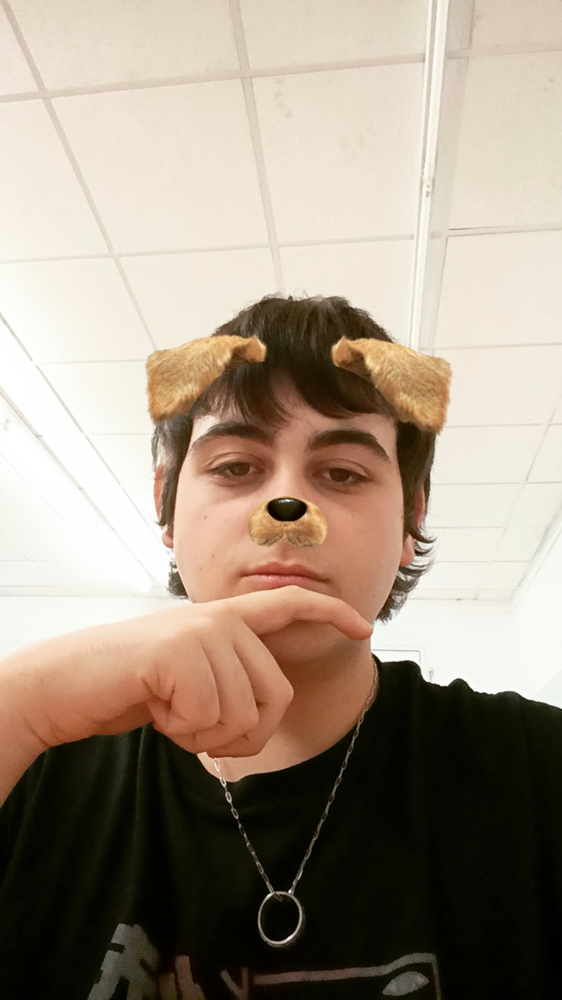

# Bienvenidos a CRS

Tu mundo, tus reglas. Crea tu propio servidor en segundos y juega sin límites.

## Fundadores

### Jose Luis y Aarón

## Quienes somos? 

- Somos 2 alumnos de SMX los cuales estan diseñando esta pagina para un trabajo de clase 

1. Aarón: Estudio SMX y me gusta bastante programar.

2. Jose Luis:  Yo tambien estudio SMX y aunque no me guste tanto programar me lo paso bastante bien.

## Nosotros

## Como funciona?

Medeiante un chat automatizado el usuario dice la modalidad, mod pack, persona,horas del server que va estar abierto, etc. Y una IA se encarga de asignarle un servidor automaticaente.

# Resultado aproximado
